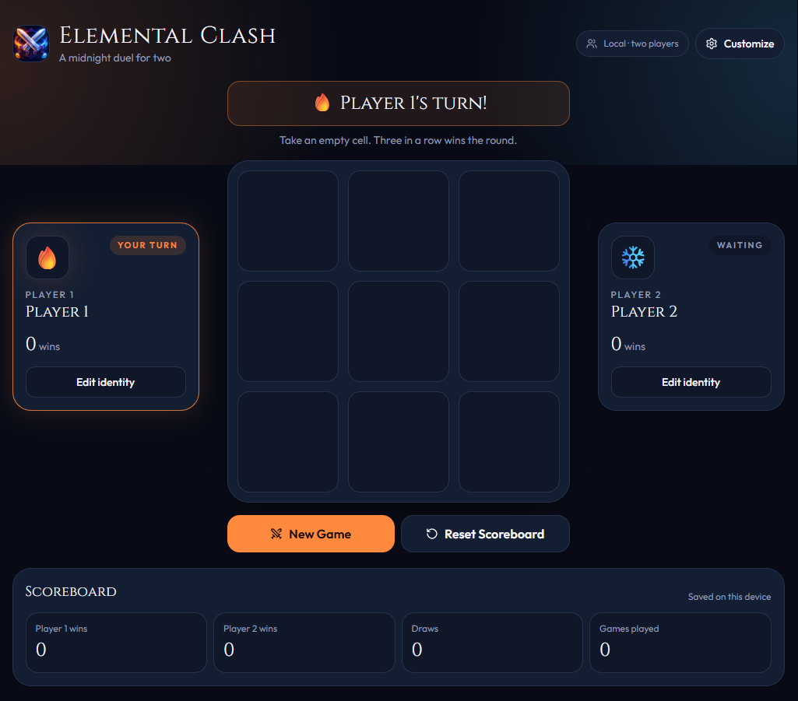
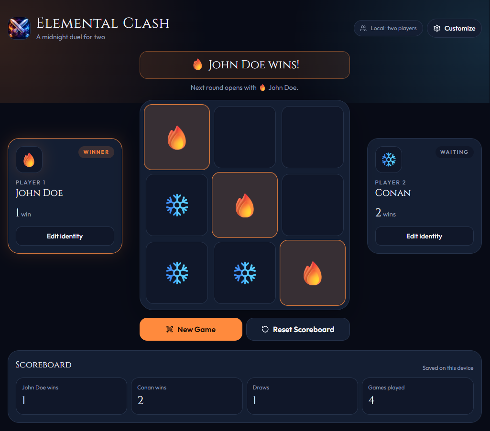

# Elemental Clash

Elemental Clash is a local two-player tic-tac-toe game with a dark fantasy arcade look. Customize player names and symbols, play on one device, and keep match scores in the browser between visits.

**[Play Elemental Clash](https://tic-tac-toe-omega-navy-76.vercel.app/)**

## Screenshots

| New round                                                    | Winning round                                                        |
| ------------------------------------------------------------ | -------------------------------------------------------------------- |
|  |  |

## Features

- Local two-player matches with alternating turns and starting players
- Automatic win and draw detection, with winning cells highlighted
- Custom player names and 16 symbols; duplicate symbols are prevented
- Scoreboard for player wins, draws, and games played
- New Game preserves scores; Reset Scoreboard asks for confirmation
- Player identities and scores persist in browser `localStorage`
- Responsive layout, keyboard-accessible board, and reduced-motion support

## Technology

- Next.js App Router
- React and TypeScript
- Tailwind CSS
- Lucide React

## Run locally

Install dependencies and start the development server:

```bash
npm install
npm run dev
```

Open [http://localhost:3000](http://localhost:3000).
